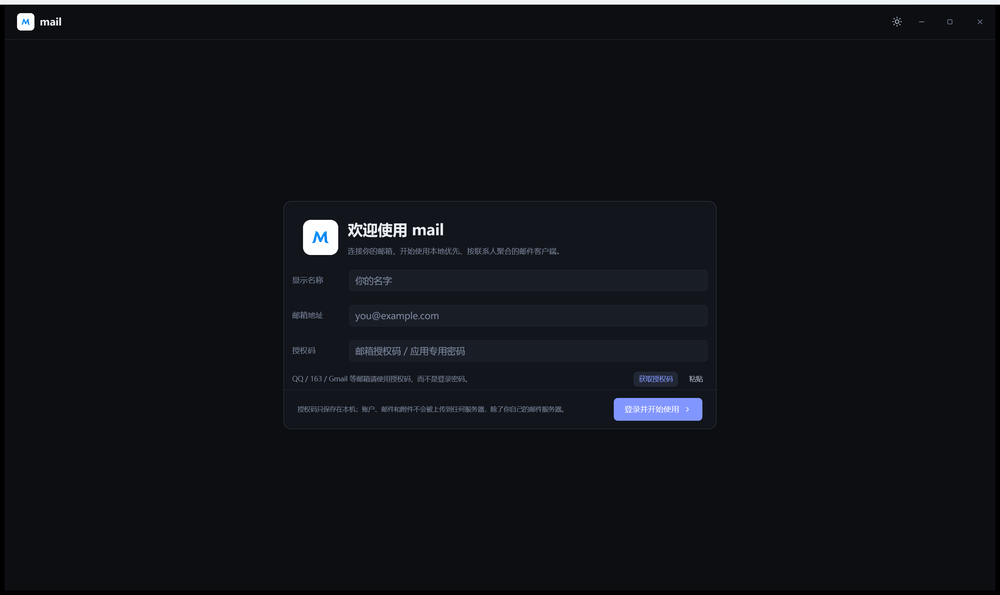

# mail-rs


一个用 **Rust + GPUI** 编写的桌面邮件客户端：启动快、界面干净、按联系人自动聚合会话。

> 项目状态：实验性个人项目。当前主要支持 **Windows 10/11**；邮件与授权码数据保存在本机，升级前建议先备份 `%APPDATA%\mail`。本项目与网易、腾讯、Google、Microsoft、Apple 均无隶属关系。

GPUI 是 Zed 编辑器使用的 GPU 加速 UI 框架。这里的输入框、正文编辑器和会话阅读视图都基于 `Element` + `EntityInputHandler` 手写，支持中文输入法、选区、光标定位与自动换行。




## 功能

- **联系人聚合**：按发件人把邮件折叠成会话。列表显示「3 封」徽标，阅读窗格按时间顺序展开整段往来，附件、未读状态一目了然。`Ctrl G` 或列表右上角的「聚合」按钮切换。
- **三栏布局**：文件夹 / 会话列表 / 阅读窗格，自适应窗口宽度，列表行固定 88px。
- **深色 + 浅色主题**，偏好持久化，`Ctrl Shift T` 切换。
- **真实邮件协议**：IMAP 同步收件箱 / 已发送 / 草稿 / 归档 / 垃圾 / 已删除等标准文件夹；带 UIDVALIDITY、增量 UID、已读/星标回写、服务器移动/删除（163 自动发 IMAP ID），SMTP 发送带超时。
- **本地优先**：SQLite 缓存账户与邮件，断网也能浏览、搜索和整理。首次启动显示欢迎登录页，登录成功后不再出现；不内置演示账户或测试邮件。
- **搜索与分页**：主题 / 发件人 / 地址 / 正文实时过滤，支持中文；可在当前文件夹和全部缓存邮件之间切换；列表分页加载，并能继续从服务器拉取更早邮件；聚合模式下按联系人过滤。
- **可逆整理**：星标、已读/未读、归档、删除、整文件夹标记已读；归档 / 删除后弹出的提示里可以直接「撤销」，归档与已删除文件夹里还有「移回收件箱」；归档/删除会尽量同步到服务器。永久删除和移除账户有二次确认。
- **可选在线翻译**：`Ctrl T` 或阅读栏的「文A」按钮，自动判断中英方向，译文直接显示在原文下方，不展示服务商信息；失败只影响译文，不影响本地功能。
- **写信**：新邮件 / 回复 / 回复全部 / 转发、抄送 / 密送、附件发送（单封总大小 25 MB 内）；收件人输入时从历史联系人中自动补全；草稿可继续编辑、每 6 秒自动保存，关闭写信窗口或应用时保存；发送后写入服务器已发送，显式保存草稿会写入服务器草稿箱。
- **授权码申请指引**：账户设置里的「获取授权码」内置 QQ / 网易 / Gmail / Outlook / iCloud 官方申请入口和分步说明，可一键打开浏览器、复制链接、填入推荐 IMAP/SMTP 服务器；在官网生成授权码后，回到设置点「粘贴」即可从剪贴板填入。
- **零配置服务器**：QQ / 163 / 126 / Gmail / Outlook / iCloud 等邮箱按后缀自动匹配 IMAP / SMTP 与 TLS 方式；界面不显示服务器字段，登录只需要邮箱地址和授权码。
- **多账户**：侧栏账户列表切换，新账户自动建默认文件夹。
- **自动同步**：真实账户启动后和每 5 分钟静默增量同步一次，有新邮件时应用内提示，并可通过系统托盘气泡通知。
- **阅读工具**：一键复制正文、列出邮件中的链接、保存或打开附件、草稿继续编辑。
- **单实例与安全**：同一时间只允许运行一个实例；永久删除 / 移除账户需要确认。
- **关闭到托盘**：点击窗口关闭按钮或 Alt+F4 默认隐藏到系统托盘，邮件继续后台同步；只有托盘右键「退出 mail」才真正结束进程。托盘图标支持左键/双击打开，右键菜单「打开 / 立即同步 / 退出」。
- **系统通知**：自动同步收到新邮件且窗口不在前台时会弹出 Windows 系统气泡通知。托盘图标要求 exe 位于普通完整性目录；如果从受限/沙箱目录启动，应用会提示不可用。
- **附件**：显示名称/大小/类型；收到的附件（≤8 MB）缓存后可保存或打开；写信时可从文件选择器添加附件；可执行文件不会被直接打开。
- **自绘输入控件**：单行输入 + 自动换行多行编辑器，支持中文输入法、选区、光标定位、`Ctrl A/C/V/X`。
- 内嵌 39 个单色 SVG 图标与品牌 logo，窗口与 exe 图标一致。

## 快捷键

| 快捷键 | 操作 | 快捷键 | 操作 |
| --- | --- | --- | --- |
| `Ctrl N` | 写新邮件 | `Ctrl Enter` | 发送 |
| `Ctrl R` | 回复 | `Ctrl Shift R` | 回复全部 |
| `Ctrl Shift F` | 转发 | `Ctrl Shift E` | 归档（会话整体） |
| `Ctrl Shift D` | 删除 | `Ctrl Shift S` | 星标 |
| `Ctrl Shift U` | 切换未读 | `Ctrl J` / `Ctrl K` | 下一段 / 上一段会话 |
| `Ctrl G` | 聚合 / 平铺切换 | `Ctrl F` | 聚焦搜索 |
| `Ctrl T` | 翻译当前邮件 | | |
| `F5` | 同步邮箱 | `Ctrl ,` | 账户设置 |
| `Ctrl Shift T` | 切换主题 | `Esc` | 关闭弹层（有内容时存草稿） |

## 连接自己的邮箱

点击左下角账户卡片（或 `Ctrl ,`）打开设置：

1. 填写显示名称、邮箱地址与**授权码**（不是登录密码）。不知道去哪里申请时，点授权码下方的「获取授权码」，选择你的邮箱服务商，按步骤在官方页面生成后回来点「粘贴」。
2. 服务器会按邮箱后缀自动识别，界面不显示服务器设置；目前支持 QQ、163、126、yeah.net、188、Gmail、Outlook、iCloud。
3. 保存后会立即尝试同步收件箱。

| 邮箱 | IMAP | SMTP | 说明 |
| --- | --- | --- | --- |
| QQ 邮箱 | `imap.qq.com:993` | `smtp.qq.com:465` | 需在设置中开启 IMAP/SMTP，使用授权码 |
| 163 | `imap.163.com:993` | `smtp.163.com:465` | 同上，使用授权码 |
| Gmail | `imap.gmail.com:993` | `smtp.gmail.com:465` | 需开启两步验证并使用应用专用密码 |
| Outlook | `outlook.office365.com:993` | `smtp.office365.com:587` | SMTP 选择 STARTTLS |
| iCloud | `imap.mail.me.com:993` | `smtp.mail.me.com:587` | 使用 App 专用密码，SMTP 选 STARTTLS |

## 独立性

- 单一 `mail.exe`，无 Electron / 浏览器内核 / 后台常驻服务，也不需要账号体系或遥测。
- 邮件收发只连你自己的 IMAP / SMTP 服务器；邮件、联系人、附件和搜索索引全部保存在本地 SQLite。
- 翻译是唯一的可选外呼：**只有你点击翻译时**才把当前邮件正文发往公开翻译服务；切换邮件、文件夹、账户或搜索后译文会自动收起，需要再次点击。译文直接显示在正文下方，不带服务商标识；不点击就不会产生任何外部请求。
- 翻译使用独立的 `translate` 模块和后台任务，网络失败只会在译文面板里显示错误，不会阻塞或影响邮件功能。

## 数据与隐私

- 数据库：`%APPDATA%\mail\mail.db`（或 `%LOCALAPPDATA%\mail`）；附件缓存位于同目录的 `attachments/`。
- 如果该目录不可写（例如受限环境），会自动回退到可执行文件旁的 `mail-data/`，即便携模式。
- **密码以明文保存在本地 SQLite 中**，仅适合个人电脑。若要分发，建议接入 Windows 凭据管理器或系统钥匙串。
- 所有邮件只在你的机器与邮件服务器之间传输，不经任何第三方。

## 构建与运行

要求：Rust 1.85+（edition 2024）、Windows 10/11（GPUI 使用 DirectX 渲染）。macOS / Linux 未做验证。

```powershell
cargo run --release
```

> 从受限/沙箱目录（例如某些 CI 工作区）直接启动时，Windows 会拒绝低完整性进程创建托盘图标。此时可运行 `scripts/launch-mail.ps1`，它会把 exe 复制到 `%LOCALAPPDATA%\mail-app` 后再启动；或手动把 `mail.exe` 复制到桌面。

产物：`target/release/mail.exe`，单文件、无运行时依赖；品牌图标已通过 Windows 资源嵌入 exe。

依赖要点：`gpui 0.2.2`、`rusqlite`（bundled SQLite）、`imap` + `native-tls`、`lettre`、`mail-parser`、`html2text`、`chrono`。

## 持续集成

`.github/workflows/ci.yml` 会在 Windows runner 上运行 `cargo test --locked`、`cargo build --release --locked`，并上传 `mail.exe` artifact。仓库不会提交 `target/`、`mail-data/`、数据库或授权码。

## 代码结构

```
src/
├── main.rs            应用入口、窗口、图标与全局快捷键
├── app.rs             应用状态、动作（写信/发送/同步/聚合/整理）与欢迎页
├── theme.rs           深色 / 浅色设计令牌
├── models.rs          账户、文件夹/UIDVALIDITY、邮件、附件、会话聚合（Thread）
├── store.rs           SQLite 持久化（账户、文件夹同步状态、邮件、草稿、设置）
├── translate.rs       可选的在线翻译（独立模块，按需调用）
├── assets.rs          内嵌 SVG 图标与 logo
├── mail/
│   ├── parse.rs       MIME 解析、HTML 转文本、附件落盘
│   ├── imap.rs        多文件夹增量同步、已读/星标回写、APPEND、移动/删除
│   └── smtp.rs        SMTP 发送
├── tray.rs            Windows 托盘图标、右键菜单与系统气泡通知
└── ui/
    ├── main_view.rs   主界面：标题栏、侧栏、会话列表、阅读器、弹层
    ├── input.rs       自绘单行输入框与多行编辑器
    └── widgets.rs     图标、logo、头像、标签等小组件
```

## 聚合是怎么做的

`models::build_threads` 以发件人邮箱为键把当前文件夹（或搜索结果）里的邮件分组，组内按时间升序排列，组间按最新一封倒序。平铺模式仍然使用原始邮件列表；切换只影响展示，不改动数据库。

阅读窗格在会话包含多封邮件时渲染为纵向的时间线卡片：每封一张卡，显示发件人、时间、正文和附件；归档、删除、标记未读会作用于整段会话，回复 / 转发针对最新一封。单一联系人的单封邮件则沿用普通阅读视图。

## 设计说明

- 深色以 `#0C0E12` 为基底，面板之间用 1px 低对比描边分隔，强调色是低饱和的星蓝 `#8296FF`；浅色主题保持同样的层级关系。
- 列表行固定 88px 高，发件人与时间同一行、主题与摘要各一行，1280px 宽度下每屏稳定 8 行以上；聚合行额外显示「N 封」徽标。
- 未读只用 6px 圆点 + 提亮文字，不用整行加粗；选中行用淡色底 + 左侧 3px 强调条。
- 联系头像不再使用彩色底 + 文字，而是无文字徽章：中性圆角底、语义线性图标（人像 / 邮件 / 服务器 / 图层 / 标签），右下角用联系人色点做区分。
- 所有图标是内嵌的单色 SVG，通过 GPUI 的 alpha 蒙版着色，随主题变化；品牌 logo 是内嵌 PNG，同时作为窗口/任务栏图标。

## 已知限制 / 后续计划

- IMAP 只映射标准文件夹（收件箱 / 已发送 / 草稿 / 归档 / 垃圾 / 已删除）；自定义服务器文件夹暂不展示。
- 每个文件夹首次同步只取最新 200 封，之后按 UID 增量；可以在文件夹底部点「从服务器加载更早邮件」继续回填，但不是一次性全量。
- 搜索可在当前文件夹和全部缓存邮件之间切换，但没有全文索引，范围仍限于本地已加载的邮件；列表每页 150 封，可点「加载更早的邮件」或从服务器补齐。
- 撰写为纯文本；HTML 邮件仍转换为纯文本阅读，不支持富文本/HTML 写信。
- 不支持多选批量操作、标签、规则/过滤器；联系人补全只基于本地已缓存邮件，不是完整通讯录。
- 会话按**发件人**聚合，尚未用 `Message-ID` / `References` 做严格线程还原。
- 在线翻译依赖公开服务的免费额度与网络；额度用完时会提示，不影响其他功能，暂不支持自定义翻译服务。
- 账号授权码仍明文保存在本地 SQLite，尚未接入 Windows 凭据管理器；exe 未做代码签名（按当前使用场景暂不处理）。
- 收到的附件超过 8 MB 不缓存；附件发送单封限 25 MB；草稿只在显式「保存草稿」时写回服务器，自动保存仅落本地。
- 自建域名或未识别的企业邮箱后缀暂不支持首次登录自动配置；Gmail/Outlook 仍未接 OAuth，只建议用应用专用密码做实验性连接。
- 服务器端 UIDVALIDITY 变化会清空并重新同步对应文件夹；服务器上被删除/移动的邮件在下次同步时修正。

这些都在后续计划中；当前版本的目标是把「快、稳、好用」的核心体验做好。

## 免责声明

- 这是个人实验项目，不提供任何明示或暗示的可用性、安全性或数据不丢失保证。
- 请使用邮箱服务商提供的**授权码 / 应用专用密码**，不要把邮箱登录密码写进公开 issue、截图或日志。
- 本项目不是网易、腾讯、Google、Microsoft 或 Apple 的官方客户端，也不代表这些公司的立场。
- 公开仓库中不应包含真实邮箱数据库、授权码、附件或个人邮件内容；发布前请确认 `git status` 中没有这些文件。

---

MIT License · 用 Rust 和一点点耐心做成。


